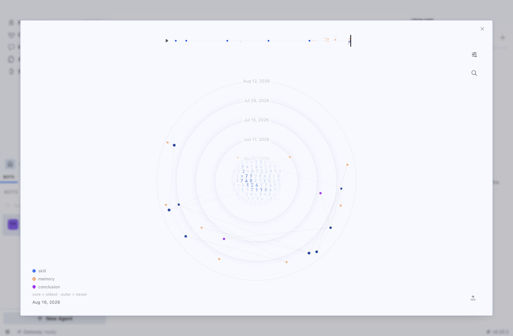

# Journey star map — a Hermes Desktop plugin

An interactive star map of what your Hermes agent has learned. It shows learned
skills, `MEMORY.md` / `USER.md` cards and, when Honcho is your memory provider, every
Honcho conclusion. Each item is a star, placed by when it was learned (core = oldest,
outer rings = newer). You can search and filter the map, trace a memory back to the
conversation it came from, and put a memory into a chat as reviewed reference text.

It is a **plugin only**. Nothing in Hermes is patched, so a Hermes update never has to
be rebased onto it.



| | |
|---|---|
| Plugin id | `journey-starmap` |
| Version | 1.0.0 |
| Hermes | v0.23.3 or later (`requires_hermes: ">=0.23.3"`); tested on v0.23.3 and v0.23.4 |
| Needs | the Hermes Desktop app; Honcho is optional |
| License | MIT |

## Features

- **Map.** Radial layout with a force simulation, pan, wheel/pinch zoom, hover
  highlighting, click selection and double-click drill-down. A timeline scrubber has
  a play-through, plus a legend and share codes for a view. Identical conclusions are
  drawn as one star with an `×N` count, with a toggle to show them separately.
- **Search and filters.** A sidebar searches card bodies, not just labels. You can
  filter by kind, source and date (range, year, month) and pulse the matches on the
  map. Saved searches and recent searches are kept.
- **Provenance.** "Where this came from…" opens the session that produced a node,
  falling back to full-text session search when none was recorded. For a Honcho
  conclusion it shows the provider's source conversation. "Recreate as Hermes
  session" imports that conversation as a normal, continuable Hermes session. This is
  idempotent: an existing session is never overwritten.
- **Recall.** "Insert into this chat" and "Add to a session" put a node into a
  composer as a draft for you to review. Nothing is sent automatically. The draft is
  wrapped as delimited, defanged reference data rather than an instruction. "Start a
  conversation about this…" seeds a new chat about a conclusion.
- **Edit and delete** skills and file-memory cards through Hermes's own mutation
  functions. **Honcho conclusions are read-only here.**
- **Multi-profile.** A profile selector merges several profiles onto one map, with a
  profile badge per node. A memory can be copied into another profile.
- **Honest loading.** The Honcho read has no card ceiling and a 30-second deadline.
  If it cannot finish, the map says *partial* instead of quietly showing fewer cards.
  Cards are cached for five minutes and refreshed in the background.

In the app the plugin adds four things:

- a **Star map (plugin)** row in the sidebar;
- an **Open the star map** command in the command palette (⌘K);
- the page at `/starmap-plugin`;
- a small `starmap: N nodes` status-bar chip.

It does not replace or change Hermes's built-in Journey view; the two coexist.

## Install

On Hermes v0.23.4 (or v0.23.3):

```bash
hermes plugins install https://github.com/P2ppyJack/journey-starmap --enable
```

`--enable` adds the plugin to `plugins.enabled`, which lets its Python backend load.
If you leave it out, run `hermes plugins enable journey-starmap` afterwards. The
plugin has no Python or Node runtime dependencies and registers no tools or hooks.
If the installer says *Restart the gateway for the plugin to take effect*, run
`hermes gateway restart` when no chat is running, so the backend routes load.

Then, in the **Hermes Desktop** app:

1. Open **Capabilities → Plugins**. If **Journey star map** is not listed yet, click
   **Rescan**.
2. Switch it **on**. Hermes ships the desktop half of a plugin package opt-in, so
   this switch is needed once.
3. Click **Star map (plugin)** in the sidebar, or press ⌘K and run **Open the star
   map**.

Check the install at any time:

```bash
hermes plugins doctor journey-starmap
```

To pin an exact release, add `--ref <40-character commit SHA>` to `hermes plugins
install`.

### Update and uninstall

```bash
hermes plugins update journey-starmap     # newest commit; the app refreshes its copy on Rescan
hermes plugins remove journey-starmap     # removes both halves
```

## Configure

With no settings, the plugin reads the Honcho scopes that belong to **you**. It works
them out from your own Honcho config (`peerName`, `aiPeer`, `userPeerAliases`):

| Role | Scope (observer → target) | Meaning |
|---|---|---|
| owner | you → you | your own conclusions about yourself |
| ai | AI peer → you | the assistant's conclusions about you |
| legacy | old id ↔ you, AI peer → old id | conclusions written under a runtime id that `userPeerAliases` now maps to you |

Other peers in the workspace are not read. The map's provider report lists them as
"peers not read", so nothing is dropped silently.

Three optional settings change that. You can edit them in the Desktop app under
**Settings → Plugins → Journey star map**, with `hermes plugins config
journey-starmap` (Hermes v0.23.4 and later), with `hermes config set` on any
version, or directly in `config.yaml`:

```yaml
plugins:
  entries:
    journey-starmap:
      settings:
        # Read these too, after the defaults. Typical use: imported chat histories.
        extra_scopes:
          - {observer: chatgpt}                    # a peer that observes itself; role defaults to "import"
          - {observer: meeting-notes, role: import}
        # Peers you deliberately do not read (test fixtures, other people).
        exclude_peers: [smoke-test-user]
        # Or replace the defaults completely, in this exact order:
        # card_scopes:
        #   - {observer: alice, target: alice, role: owner}
        #   - {observer: hermes, target: alice, role: ai}
        #   - [chatgpt, chatgpt, import]           # the list form works too
```

The same setting from a terminal, on any version:

```bash
hermes config set plugins.entries.journey-starmap.settings.extra_scopes '[{"observer": "chatgpt"}]'
```

- `role` is one of `owner`, `ai`, `legacy`, `import`. It sets the card's label and
  colour.
- `target` defaults to `observer`. Peer ids are cleaned the same way the Honcho
  provider cleans them.
- An entry that cannot be read is skipped and reported in the map's provider report.
  It is never guessed at.
- A settings change takes effect on the next load; the card cache never hides it.

Without Honcho, the map shows skills and the `MEMORY.md` / `USER.md` cards only.

## How it works

The package has two halves, installed together:

```
journey-starmap/
├── plugin.yaml              # manifest (v2): settings schema, requires_hermes
├── __init__.py              # no-op register(): no tools, no hooks
├── dashboard/
│   ├── manifest.json        # mounts the backend at /api/plugins/journey-starmap/
│   └── plugin_api.py        # FastAPI router (runs in the Hermes plugin host)
└── desktop/
    └── plugin.js            # prebuilt desktop half (the app copies it on install/Rescan)
```

- **Backend.** `GET /graph` calls Hermes's own `build_learning_graph()` for skills and
  memory files, then adds the Honcho conclusion cards. File-card node ids stay exactly
  as Hermes assigns them; provider cards follow `memory:<source>:<index>:<fingerprint>`.
  Every route is profile-scoped through the dashboard's own profile handling. The
  other routes:
  - `/health`, `/provider-cards`
  - `/node/{id}` for `GET`, `PUT` and `DELETE` (provider cards refuse edits)
  - `/recall-draft`, `/node/cross-insert`, `/provider-session`, `/materialize`
  - `/session/{id}`, `/sessions/search`, `/sessions/recent`
- **Desktop half.** A single ES module built from `src/` with esbuild. Its only
  imports are `@hermes/plugin-sdk`, `react` and `react/jsx-runtime`, which the app
  provides. It reaches its backend only through the SDK's `ctx.rest`.
- **Writes.** The plugin writes to disk only when you ask it to:
  - editing or deleting a skill or memory card;
  - inserting a memory into another profile, through the memory tool's locked,
    threat-scanned add;
  - importing a session with "Recreate as Hermes session".

  It never writes to Honcho.

### Validation

`hermes plugins validate` passes on v0.23.4 with two review notes, both deliberate:

- **Private core imports (catalog rule 9).** The backend calls Hermes's own
  learning-graph, session, profile and memory-provider functions, so the map matches
  what Hermes itself knows. Examples are `agent.learning_graph`,
  `agent.learning_mutations` and `hermes_cli.web_routers.sessions`. These imports are
  tested against v0.23.3 and v0.23.4. A future Hermes release could rename one, which
  is why CI runs the test suite against stock Hermes releases.
- **`window.hermesDesktop` (catalog rule 8).** The plugin uses it once, optionally, to
  pause the map's animation while the window is minimized. The SDK has no
  window-state API. Without the bridge the plugin falls back to the standard
  `visibilitychange` event.

## Develop

The desktop half is prebuilt, so the plugin has no runtime Node dependencies. The build
tooling's `package.json` lives in `tools/` rather than at the package root, because
Hermes's installer treats a root `package.json` as runtime dependencies and offers to
install them. Never put `node_modules` inside `desktop/`: the app copies that folder
and refuses symlinks in it.

```bash
npm ci --prefix tools --no-audit --no-fund   # build tooling from the lockfile

node build.mjs              # src/ → desktop/plugin.js
node build.mjs --register   # run the real register() against a stub ctx
node build.mjs --smoke      # render the scene against a stub 2D canvas
node tests/eval-bundle.mjs  # import the shipped bundle with generated stubs
```

The committed `desktop/plugin.js` is reproducible. In a clean checkout,
`npm ci --prefix tools && node build.mjs` rebuilds it byte-for-byte, and CI checks this
on every push. `build.mjs` also finds the tooling in `./node_modules` or in a sibling
`../journey-starmap-plugin-deps` folder. Those builds give the same code; only
esbuild's file-path comments change.

Backend tests run inside a Hermes checkout:

```bash
git clone --depth 1 --branch v0.23.4 https://github.com/NousResearch/hermes-agent.git
cd hermes-agent && uv sync --frozen --python 3.14 --no-dev && uv pip install pytest
PYTHONPATH=. .venv/bin/python -m pytest /path/to/journey-starmap/tests -q
.venv/bin/hermes plugins validate /path/to/journey-starmap
```

On stock Hermes one test skips by design. It compares the plugin's recall composer
with a core composer that stock Hermes does not ship.

For live development, link the checkout:
`ln -s "$PWD" ~/.hermes/plugins/journey-starmap`. The app then re-syncs
`desktop/plugin.js` on every save; after a desktop change, run **Reload desktop
plugins** from ⌘K. A backend change takes effect only when the process serving the
plugin's routes restarts. For the Desktop app that is the gateway, so run
`hermes gateway restart` when no chat is running (the same step the installer asks
for). A separate `hermes dashboard` serves its own copy and needs its own restart.

`core-port/` keeps the original web-dashboard Star Journey sources for reference. It
is not built or installed; see [`core-port/README.md`](core-port/README.md).

## Known limits

- The page is **Star map (plugin)** at `/starmap-plugin`. The built-in Journey view
  and its `/journey` command belong to Hermes and stay as they are.
- Menu submenus are shown as labelled groups, because the SDK's dropdown has no
  submenu primitive. Every action is present.
- In the browser (webapp) build of Hermes Desktop, right-clicking a node can also
  open the app's own context menu next to the plugin's.
- Multi-profile views are scoped by profile name. If two connections expose the same
  profile name, it resolves to the active gateway's backend.

## Screenshots

Screenshots 02–13 in [`docs/screenshots/`](docs/screenshots/) were captured with demo
data from the same feature. They show search, provenance, the source corpus, recall,
the profile selector and cross-profile insert. In this plugin the page is titled
**Star map (plugin)**.

## History

1.0.0 is the first release as a plugin. Releases 0.3.0 and 0.4.0 shipped the same
feature as a source patch against one pinned Hermes commit. They remain available as
the `v0.4.0` tag and are no longer developed. See [CHANGELOG.md](CHANGELOG.md).

## Credits

Prepared by a Custom Agentic Assistant built and developed in part by Tobias Musser

## License

MIT. See [LICENSE](LICENSE).
